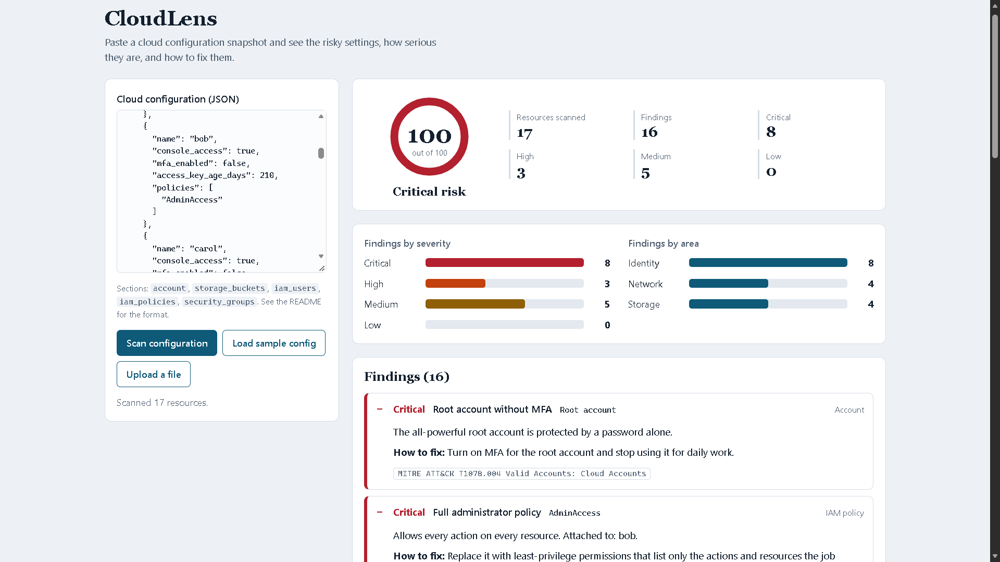
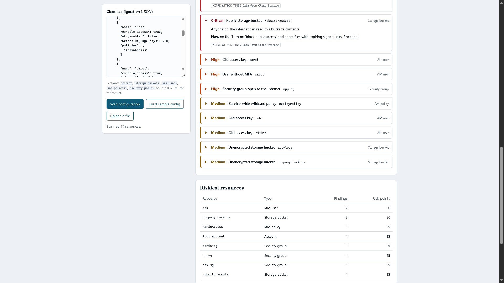

# CloudLens

   

   

A cloud security configuration scanner. Paste a snapshot of a cloud environment (storage buckets, users, permissions and firewall rules) and CloudLens flags the risky settings, rates how serious they are, and explains how to fix each one. Python standard library only, so there is nothing to install.

## Run it

1. Install Python 3.8 or newer.
2. Open this folder in VS Code, then open the terminal (Ctrl+`).
3. Start the server:
   - Windows: `py app.py`
   - Mac/Linux: `python3 app.py`
4. Open http://127.0.0.1:8000 in your browser.
5. Select **Load sample config** to see the demo.

Use a different port with `py app.py 9000`.

## Run the tests

    py -m unittest -v

(`python3 -m unittest -v` on Mac/Linux.) All 53 tests should pass.

## What it checks

| Rule | Severity | MITRE ATT&CK |
|---|---|---|
| Public storage bucket | Critical | T1530 |
| Unencrypted storage bucket | Medium | - |
| Full administrator policy (`*` on `*`) | Critical | T1078.004 |
| Wildcard actions policy (`*` on named resources) | High | T1078.004 |
| Service-wide wildcard policy (`ec2:*` on `*`) | Medium | T1078.004 |
| Console user without MFA | High (Critical if the user is an administrator) | T1078.004 |
| Root account without MFA | Critical | T1078.004 |
| Access key older than 90 days | Medium (High after 365 days) | T1078.004 |
| Security group open to the internet | Critical for all ports or sensitive ports (SSH, RDP, databases), High for other ports except 80 and 443 | T1190, T1133 |

Risk score: critical findings add 25 points, high 12, medium 5, low 2, capped at 100.

## Input format

CloudLens reads a simplified JSON snapshot with up to five sections. Missing fields are never guessed: a bucket with no `public_access` field raises nothing.

```json
{
  "account": {"root_mfa_enabled": false},
  "storage_buckets": [
    {"name": "backups", "public_access": true, "encrypted": false}
  ],
  "iam_users": [
    {"name": "bob", "console_access": true, "mfa_enabled": false,
     "access_key_age_days": 210, "policies": ["AdminAccess"]}
  ],
  "iam_policies": [
    {"name": "AdminAccess",
     "statements": [{"effect": "Allow", "actions": ["*"], "resources": ["*"]}]}
  ],
  "security_groups": [
    {"name": "admin-sg",
     "ingress": [{"port_from": 22, "port_to": 22, "cidr": "0.0.0.0/0"}]}
  ]
}
```

Entries of the wrong type, and firewall rules with non-numeric ports, are skipped and counted on the dashboard.

## Files

- `app.py` - web server and JSON API (`/api/analyze`, `/api/sample`)
- `scanner.py` - the rules, risk score and sample data (one small function per rule)
- `static/index.html` - the dashboard (HTML, CSS and JavaScript in one file)
- `test_cloudlens.py` - automated tests

## Code quality

Formatted with Black, rated 10/10 by Pylint, no findings from Bandit.

    py -m pip install black pylint bandit
    py -m black .
    py -m pylint scanner.py app.py test_cloudlens.py
    py -m bandit -r .

## Limitations

- The input is a simplified format, not the raw output of a cloud provider's API.
- It checks nine common problems. It is a learning project, not a replacement for tools like Prowler, ScoutSuite or the cloud providers' own security services.
- It never connects to a cloud account; it only reads the JSON you give it.

## Ideas to extend it

- Convert real AWS CLI output (or Terraform plans) into the snapshot format
- Add more rules: logging turned off, unused users, public databases
- Map findings to CIS Benchmark controls

## How it was built

Built with the help of an AI assistant (Claude). Author: Anshra.
